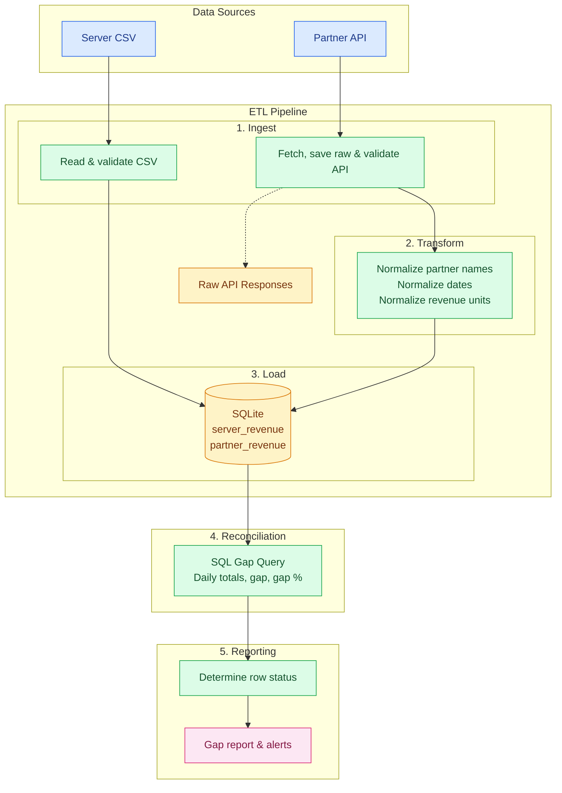

# Partner Revenue Reconciliation

A revenue reconciliation tool that compares internal server revenue with revenue reported by advertising partners, identifying discrepancies and missing data.

The tool:

1. Reads the server revenue CSV and fetches partner reports from the API, preserving the original API responses.
2. Validates the input data and normalizes partner names, reporting dates, and revenue units.
3. Loads both data sources into a SQLite database.
4. Calculates daily revenue gaps per partner in SQL, both as monetary amounts and percentages.
5. Generates a reconciliation report and alerts for the most recent reporting day, flagging gaps exceeding 10% in either direction and missing partner data.

The tool is implemented in TypeScript (Node.js 24), using the original server revenue CSV and Python mock API provided in the starter project.

## How to Run

### Requirements

- Node.js 24 or newer
- Python 3.10 or newer (for the mock API)

### Installation

Install the project dependencies:

```bash
npm ci
```

### Run the Reconciliation

In the first terminal, start the mock API:

```bash
python3 mock_api/server.py
```

In a second terminal, run the reconciliation:

```bash
npm run reconcile
```

The raw API responses are saved under `raw/`, and the SQLite database is created at `reconcile.db`. Both are rebuilt on every run.

### Run Tests

```bash
npm test
```

Tests run independently of the mock API.

### Configuration

The mock API runs on port 8000 by default. To use a different port:

```bash
PORT=8080 python3 mock_api/server.py
```

```bash
PARTNER_API_BASE_URL=http://127.0.0.1:8080 npm run reconcile
```

Application settings are defined in `src/config/appConfig.ts`, while business rules are defined in `src/config/businessConfig.ts`.

## Example Output

```text
Revenue reconciliation
  Server rows:   154 (2026-10-18 to 2026-10-31)
  Partner rows:  152
  Database:      /path/to/reconcile.db

Daily gaps per partner
┌─────────┬──────────────┬──────────────────┬────────────────┬─────────────────┬────────┬────────┬───────────────────┐
│ (index) │ date         │ partner          │ server revenue │ partner revenue │ gap    │ gap %  │ status            │
├─────────┼──────────────┼──────────────────┼────────────────┼─────────────────┼────────┼────────┼───────────────────┤
│ 0       │ '2026-10-18' │ 'Index Exchange' │ 358.44         │ 362.77          │ 4.33   │ 1.21   │ 'OK'              │
│ ...     │              │                  │                │                 │        │        │                   │
│ 65      │ '2026-10-31' │ 'Index Exchange' │ 364.96         │ 369.77          │ 4.81   │ 1.32   │ 'OK'              │
│ 66      │ '2026-10-31' │ 'Magnite'        │ 520.56         │ 527.01          │ 6.45   │ 1.24   │ 'OK'              │
│ 67      │ '2026-10-31' │ 'OpenX'          │ 579.86         │ null            │ null   │ null   │ 'NO PARTNER DATA' │
│ 68      │ '2026-10-31' │ 'PubMatic'       │ 483.31         │ 478.22          │ -5.09  │ -1.05  │ 'OK'              │
│ 69      │ '2026-10-31' │ 'Sovrn'          │ 417.08         │ 347.08          │ -70    │ -16.78 │ 'GAP'             │
└─────────┴──────────────┴──────────────────┴────────────────┴─────────────────┴────────┴────────┴───────────────────┘

Alerts for 2026-10-31 (gap over 10%, or no partner data)
┌─────────┬─────────┬───────────────────┬──────┬────────┐
│ (index) │ partner │ status            │ gap  │ gap %  │
├─────────┼─────────┼───────────────────┼──────┼────────┤
│ 0       │ 'OpenX' │ 'NO PARTNER DATA' │ null │ null   │
│ 1       │ 'Sovrn' │ 'GAP'             │ -70  │ -16.78 │
└─────────┴─────────┴───────────────────┴──────┴────────┘
```

- **Gap** — partner revenue minus server revenue.
- **Gap %** — the revenue gap as a percentage of server revenue.
- **null** — indicates missing revenue data or an undefined calculation, rather than a numeric value of zero.

## How It Works



Server revenue records are validated during ingestion and loaded directly into the database, while partner records undergo normalization before loading.

## Project Structure

```text
programmaticx-reconciliation/
├── src/
│   ├── main.ts                 Entry point & pipeline orchestration
│   ├── config/
│   │   ├── appConfig.ts        Paths, API address and timeout
│   │   └── businessConfig.ts   Gap threshold, time zone, partner rules
│   ├── ingest/                 1. Ingest
│   │   ├── serverCsv.ts        Read and validate the server CSV
│   │   └── partnerApi.ts       Fetch each day, save raw, validate
│   ├── transform/              2. Transform
│   │   └── partnerRows.ts      Partner names, Israel day, revenue units
│   ├── db/                     3. Load and 4. Reconciliation
│   │   ├── schema.ts           CREATE TABLE statements
│   │   ├── queries.ts          Inserts and the gap query
│   │   └── database.ts         Create, load, run the gap query
│   ├── report/                 5. Reporting
│   │   ├── status.ts           Status for each row
│   │   ├── alerts.ts           Alerts for the most recent day
│   │   └── printReport.ts      Print the gap table and the alerts
│   ├── types/
│   │   └── revenue.ts          Row types and the status constants
│   └── utils/
│       └── dates.ts            Date helpers
├── tests/                      Run with npm test
│   ├── partnerRows.test.ts     Cleaning rules
│   ├── report.test.ts          Status and alerts
│   └── gaps.test.ts            Gap query rounding, on an in-memory database
├── data/
│   └── server_revenue.csv      Server revenue
├── mock_api/                   Mock partner API (Python)
├── raw/                        Raw API responses (created on run)
├── reconcile.db                SQLite database (created on run)
├── package.json
├── package-lock.json           Exact dependency versions, used by npm ci
├── tsconfig.json
└── README.md
```

## Data Quality and Validation

### General Validation Rules

- **Fail-fast validation** — every CSV and API row is validated for required fields, numeric revenue, and valid dates. Invalid records stop the run with an error rather than allowing unreliable data into the report.
- **Timestamp-based date normalization** — API records are assigned to their actual reporting day rather than the requested date. UTC timestamps are converted using the `Asia/Jerusalem` time zone, accounting for daylight saving time, including the transition on 2026-10-25.
- **Missing data is not zero** — missing revenue is represented as `NULL`, distinguishing an absent report from actual zero revenue and preventing misleading percentage gaps.
- **Automated tests** — `npm test` covers data cleaning, status classification, alert generation, and SQL rounding.

### Dataset-Specific Findings

The raw API data and server CSV were manually reviewed and compared using DataGrip. Two partner-specific inconsistencies were identified. Both required assumptions that should be verified before applying these rules in production.

#### Magnite — Inconsistent Partner Names

- **Problem:** The API identifies Magnite as `Magnite`, `magnite inc.`, and `MGNI`. Treating these as separate partners would produce incorrect reconciliation results.
- **Assumption:** All three identifiers represent the same partner. `MGNI` is Magnite's stock ticker, and the revenue records align with the server data within approximately 2%.
- **Fix:** All three identifiers are normalized to `Magnite`, matching the server CSV.
- **In production:** Confirm the mapping with the account manager and request a stable partner identifier instead of relying on free-text names.

#### PubMatic — Revenue Unit Mismatch

- **Problem:** PubMatic's reported revenue is approximately 100 times higher than the corresponding server revenue.
- **Assumption:** PubMatic reports revenue in cents rather than dollars. This is supported by a consistent ratio of 98–102 across matching records and the fact that all PubMatic revenue values are integers.
- **Fix:** PubMatic's revenue is divided by 100 using a configurable normalization rule. The original values remain unchanged in the saved raw responses.
- **In production:** Verify the revenue unit against the partner's API documentation and cross-check the normalized figures against its dashboard or invoice.

### Results

After normalization, all comparable revenue gaps are below 2%, except for one significant discrepancy.

The latest reporting day (2026-10-31) contains two actionable findings:

- **Sovrn:** a revenue gap of -16.78%.
- **OpenX:** missing partner revenue data.

## Additional Design Decisions

### Tools

- **`node:sqlite` and `node:test`** — built into Node.js, reducing external dependencies and keeping the setup simple.

### Reconciliation

- **Complete coverage** — the SQL query uses `UNION` to combine all unique `(date, partner)` pairs from both sources, followed by `LEFT JOIN` to attach the corresponding revenue totals, preserving records even when data is missing from either side.
- **Rounding** — values are rounded to two decimal places in SQL to maintain consistency between reported values and alert decisions, avoiding unnecessary alerts for negligible deviations from the threshold.

### Reporting

- **Reference date** — the latest date in the server CSV is used as "yesterday", regardless of row order.
- **Centralized status logic** — the report and alerts share the same status calculation to ensure consistency.
- **Alert scope** — missing server data is reported but does not trigger an alert, keeping alerts aligned with the two conditions defined in the brief.

## Proposed Feature — Partner Alias Management

### Problem

During data validation, Magnite was found under three different names. Currently, these aliases are mapped in the code.

An unrecognized alias is treated as a separate partner with a `NO SERVER DATA` status, while the actual partner's reported revenue may be incomplete. This can produce misleading reconciliation results and false alerts, requiring developer intervention.

### Proposed Solution

Move partner name mappings from the code to a persistent database table and introduce a dedicated data quality alert for unrecognized partner names.

This would allow the operations team to verify and manage partner aliases independently, without requiring code changes or redeployment.

### Implementation

- Create a `partner_aliases` table containing aliases and their corresponding canonical partner names.
- Store the mapping table in a separate, persistent database that is not rebuilt on each run.
- Update the transformation step to use database mappings instead of hardcoded rules.
- Generate a dedicated `UNKNOWN PARTNER NAME` alert for unrecognized partner names without interrupting the reconciliation pipeline or report generation.
- Provide a simple management interface or CLI for approving and updating mappings.
- Reprocess the affected data after a mapping is approved.

Until a mapping is approved, records with unrecognized partner names would remain in the report under their original names. New aliases would require human verification rather than automatic matching to prevent incorrect revenue attribution.

This feature would improve the reliability of revenue reports, reduce false alerts, and allow the revenue team to focus on genuine financial discrepancies rather than data naming inconsistencies.

## AI Usage and Verification

### AI-Assisted Development

- **ChatGPT** — understanding the brief, building a general work plan, and preparing the initial prompt for Claude Code.
- **Claude Code** — implementing the solution collaboratively, step by step.
- **ChatGPT and Gemini** — providing second opinions when Claude Code's suggestions appeared questionable or required further evaluation.

### Verification Process

- **Small, reviewed commits.** Development was organized into small, focused commits, and each one was reviewed before it was committed.
- **Run before every commit.** Before each commit, the automated tests and the program were run, and the output was checked against the step being built (for example the cleaned partner rows, the gap query results, or the statuses).
- **Manual data verification.** The original CSV and API data were inspected and compared using DataGrip to evaluate reconciliation results and normalization assumptions.
- **Critical evaluation of suggestions.** AI suggestions were reviewed and challenged when necessary. Some were rejected in favor of simpler solutions, such as replacing a reverse lookup mechanism for partner aliases with a single map. Others were cross-checked using additional sources or AI tools.
