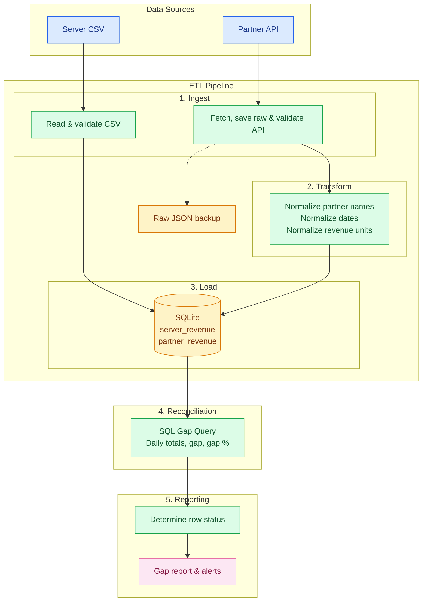

# Partner Revenue Reconciliation

A company that sells ad space works with several ad partners. Every day, the company's servers record how much revenue each partner brought in (the "server revenue"). Each partner also reports its own figure for the same day, through an API. The two figures should be close, and when they are not, someone needs to look into it.

This tool compares the two sources for every day and every partner:

1. It fetches the partner reports from the API and saves them exactly as they arrived.
2. It cleans the partner data, so both sources use the same partner names, days and units.
3. It loads both sources into a SQLite database.
4. It calculates the gap per day and partner in SQL, as an amount and as a percentage.
5. It prints a table of all the gaps, and alerts for the most recent day: a gap over 10%, or a partner that sent no data.

The tool is written in TypeScript (Node 24). The partner API is simulated by a small Python server in `mock_api/`, and the server revenue is in `data/server_revenue.csv`.

## How to run

### Requirements

You need Node 24 or newer, and Python 3.10 or newer for the mock API. To check:

```bash
node --version
python3 --version
```

To install and use the matching versions:

```bash
nvm install 24
pyenv install 3.12
pyenv shell 3.12
```

### Install and run

Install the project's packages:

```bash
npm ci
```

In one terminal, start the mock API. It listens on `http://127.0.0.1:8000`:

```bash
python3 mock_api/server.py
```

In a second terminal, run the reconciliation:

```bash
npm run reconcile
```

The raw API responses are saved under `raw/`, and the database is written to `reconcile.db`. Both are rebuilt on every run.

To run the tests (the mock API is not needed):

```bash
npm test
```

The mock API uses port 8000. To use another port, for example 8080, start it with `PORT` and pass the same address to the reconciliation:

```bash
PORT=8080 python3 mock_api/server.py
PARTNER_API_BASE_URL=http://127.0.0.1:8080 npm run reconcile
```

The default address is set in `src/config/appConfig.ts`.

## Output

```text
Revenue reconciliation
  Server rows:   154 (2026-10-18 to 2026-10-31)
  Partner rows:  152
  Database:      /path/to/reconcile.db

Daily gaps per partner
┌─────────┬──────────────┬──────────────────┬────────────────┬─────────────────┬────────┬────────┬───────────────────┐
│ (index) │ date         │ partner          │ server revenue │ partner revenue │ gap    │ gap %  │ status            │
├─────────┼──────────────┼──────────────────┼────────────────┼─────────────────┼────────┼────────┼───────────────────┤
│ 0       │ '2026-10-18' │ 'Index Exchange' │ 358.44         │ 362.77          │ 4.33   │ 1.21   │ 'OK'              │
│ ...     │              │                  │                │                 │        │        │                   │
│ 65      │ '2026-10-31' │ 'Index Exchange' │ 364.96         │ 369.77          │ 4.81   │ 1.32   │ 'OK'              │
│ 66      │ '2026-10-31' │ 'Magnite'        │ 520.56         │ 527.01          │ 6.45   │ 1.24   │ 'OK'              │
│ 67      │ '2026-10-31' │ 'OpenX'          │ 579.86         │ null            │ null   │ null   │ 'NO PARTNER DATA' │
│ 68      │ '2026-10-31' │ 'PubMatic'       │ 483.31         │ 478.22          │ -5.09  │ -1.05  │ 'OK'              │
│ 69      │ '2026-10-31' │ 'Sovrn'          │ 417.08         │ 347.08          │ -70    │ -16.78 │ 'GAP'             │
└─────────┴──────────────┴──────────────────┴────────────────┴─────────────────┴────────┴────────┴───────────────────┘

Alerts for 2026-10-31 (gap over 10%, or no partner data)
┌─────────┬─────────┬───────────────────┬──────┬────────┐
│ (index) │ partner │ status            │ gap  │ gap %  │
├─────────┼─────────┼───────────────────┼──────┼────────┤
│ 0       │ 'OpenX' │ 'NO PARTNER DATA' │ null │ null   │
│ 1       │ 'Sovrn' │ 'GAP'             │ -70  │ -16.78 │
└─────────┴─────────┴───────────────────┴──────┴────────┘
```

`gap` is the partner's revenue minus ours, and `gap %` is that gap as a percentage of our revenue. `null` means a source sent no data for that day, which is different from 0.

## How it works



The server rows need no cleaning, so they go straight from Ingest to the database.

## Project structure

```text
programmaticx-reconciliation/
├── src/
│   ├── main.ts                 Entry point: runs every step in order
│   ├── config/
│   │   ├── appConfig.ts        Paths, API address and timeout
│   │   └── businessConfig.ts   Gap threshold, time zone, partner rules
│   ├── ingest/                 1. Ingest
│   │   ├── serverCsv.ts        Read and validate the server CSV
│   │   └── partnerApi.ts       Fetch each day, save raw, validate
│   ├── transform/              2. Transform
│   │   └── partnerRows.ts      Partner names, Israel day, PubMatic cents
│   ├── db/                     3. Load and 4. Reconciliation
│   │   ├── schema.ts           CREATE TABLE statements
│   │   ├── queries.ts          Inserts and the gap query
│   │   └── database.ts         Create, load, run the gap query
│   ├── report/                 5. Reporting
│   │   ├── status.ts           Status for each row
│   │   ├── alerts.ts           Alerts for the most recent day
│   │   └── printReport.ts      Print the gap table and the alerts
│   ├── types/
│   │   └── revenue.ts          Row types and the status constants
│   └── utils/
│       └── dates.ts            Date helpers
├── tests/                      Run with npm test
│   ├── partnerRows.test.ts     Cleaning rules
│   ├── report.test.ts          Status and alerts
│   └── gaps.test.ts            Gap query rounding, on an in-memory database
├── data/
│   └── server_revenue.csv      Server revenue
├── mock_api/                   Mock partner API (Python)
├── raw/                        Raw API responses (created on run)
├── reconcile.db                SQLite database (created on run)
├── package.json
└── tsconfig.json
```

## How the numbers are kept correct

### For any input

These rules hold for any data. Some were found while reviewing this data, but none of them depends on a specific partner.

- **A broken row stops the run.** Every CSV row and API row is checked: all fields are there, revenue is a number, and dates are real dates. If a row is broken, the run stops with an error, so the report is never built on data the code cannot trust.
- **A record's day comes from its timestamp.** Asking the API for one date can return records from another day, so grouping by the requested date would put records on the wrong day. Each record's day is its UTC `timestamp` converted to Israel time, the same as the server CSV dates. The conversion uses the time zone, not a fixed offset, because Israel moves from UTC+3 to UTC+2 on 2026-10-25.
- **A partner with no data is never a zero.** Counted as 0, it would look like a -100% gap. Its revenue stays empty (`NULL`) and it gets its own alert, `NO PARTNER DATA`. In this data, OpenX sent nothing for 2026-10-31.
- **Tests** (`npm test`) cover the cleaning rules, the status rules, the alerts, and the rounding in the gap query.

### On the provided data

The rows and the numbers were reviewed manually in DataGrip, comparing the raw API data with the server CSV. Two problems are specific to one partner and could only be solved with an assumption. For each one: the assumption, how it was reached, the fix built on it, and how it would be confirmed in production before relying on it.

#### Magnite under three names

- **Problem:** the API uses `Magnite`, `magnite inc.` and `MGNI`. Kept apart, Magnite's revenue would split into three partners, each with a false gap.
- **Assumption:** all three are the same partner. Magnite, Inc. is a public company traded as `MGNI`, so one name is the legal name and one is the stock ticker. In the data, each day has one row per Magnite bundle under only one of the names, and the amounts match the server CSV within about 2%.
- **Fix:** the three names are mapped to `Magnite`, the name in the server CSV.
- **In production:** confirm with the account manager for Magnite that these are one account, and ask the partner for a stable partner ID instead of a free-text name.

#### PubMatic in cents

- **Problem:** PubMatic's values are about 100 times the server figures, for example `17616` against `178.70`. Taken as dollars, PubMatic would show a gap of about +9,800% every day.
- **Assumption:** PubMatic reports in cents. On every row, for every day, the ratio to the server figure is between 98 and 102, and every PubMatic value is a whole number, while the other partners' values have cents. A real jump in revenue would not come out at ×100 on every row for two weeks.
- **Fix:** PubMatic's values are divided by 100. The rule is listed in the config, not hidden in the code, and the raw files keep the original values.
- **In production:** check the unit in PubMatic's API documentation or with the account manager, and compare one day with PubMatic's own dashboard or invoice.

#### Result

After these fixes, every gap is under 2%, except one real gap: Sovrn on 2026-10-31, at -16.78%.

## Decisions log (working notes, to be rewritten into the final README)

### Ingest

- **Rewritten in TypeScript** (Node 24). `mock_api/` and the data files are unchanged.
- **Raw responses are saved byte-for-byte** as `raw/report_<day>.json` before any parsing. Checked with `cmp` against a live `curl` of the API.
- **Fetch range:** from the day before the first CSV date to the last CSV date. Partner timestamps are UTC, and records from late evening UTC fall on the next day in Israel, so the day before is needed. We fetch every day in that range, not only the dates that appear in the CSV. If our server had no rows for a day, that day still gets fetched, and the partner's revenue shows up as a gap instead of quietly disappearing. The Python starter does the same.
- **The day a row belongs to comes from its `timestamp`, not from the `date` we asked the API for.** In the data, `2026-10-24` returns no rows, and `2026-10-25` returns rows for two Israel days.
- **Parse = shape check only.** Each source is parsed and validated in `src/ingest/`: JSON or CSV into typed rows, and every field is checked for the right type. No values are changed there. Cleaning happens in `src/transform/`.
- **Bad input stops the run (fail fast).** Invalid JSON, a missing `rows` array, or any malformed row throws a clear error, and nothing is loaded or reported. A report built on partial data could show a wrong gap without anyone noticing. There are no malformed rows in the current data (all 152 partner rows and 154 server rows pass).
    - _Next step:_ move bad rows into a quarantine list with a reason, keep the run going, and mark that partner and day as "incomplete" in the report instead of computing a gap.

### Project structure

- The folders follow the ETL stages, but each one is named for what it does: `src/ingest/` (extract: fetch, save raw, validate shape), `src/transform/` (clean and convert values), and `src/db/` (load into SQLite, plus the gap query). It is called `db/` and not `load/` because it also holds the gap query.
- **After ETL comes the report**, in `src/report/`: `status.ts` decides a status for each row, `alerts.ts` picks the rows to alert on, and `printReport.ts` prints. SQL calculates, TypeScript decides and prints.

### Transform

- **Partner names:** the names in our CSV are the canonical ones, because the CSV is our own record and its names are consistent. An explicit alias map in `src/config/businessConfig.ts` maps `magnite inc.` and `MGNI` to `Magnite`. The alias is the key, so one alias can never belong to two partners (the same shape as an `alias PRIMARY KEY` table). Matching is exact, with no case folding or trimming, because the data has no such variants. An unknown name passes through unchanged and does not stop the run, so it shows up in the report as its own partner with no server revenue instead of disappearing.
- **Why the three Magnite names are one partner:**
    - Magnite, Inc. is a real SSP listed on NASDAQ as `MGNI`, so one name is the legal name and one is the stock ticker.
    - In the data, every Israel day has exactly one row for each of Magnite's two bundles in our CSV (`com.news.daily`, `com.games.arcade`), never two rows for the same bundle. The names rotate from day to day, and each amount is within about 2% of our CSV.
    - In a real company this would be confirmed with the partnerships or ad-ops team.
    - _Next step:_ ask the partner API for a stable `partner_id` and match on that instead of free-text names. There is no such ID in the data today.
- **Partner dates:** each partner row's day is the Israel (`Asia/Jerusalem`) calendar day of its UTC `timestamp`, using `Intl.DateTimeFormat`. It is not a fixed +2 or +3 hours, because Israel moved from UTC+3 to UTC+2 on 2026-10-25, in the middle of our data.
    - Checked on the boundaries: `2026-10-24T20:59:59Z` is still 2026-10-24, `21:00:00Z` is 2026-10-25 (UTC+3). After the clock change, `2026-10-25T21:59:59Z` is still 2026-10-25, and `22:00:00Z` is 2026-10-26 (UTC+2).
    - Checked on the data: after conversion, every Israel day from 2026-10-18 to 2026-10-30 has exactly 11 partner rows, the same count as our CSV. 2026-10-31 has 9, because OpenX sent nothing.
- **PubMatic revenue is divided by 100 (assumption: the API reports it in cents).** The rule is listed in `businessConfig.partnersReportingInCents`, not hidden in the code, and the raw files keep the original values.
    - _Evidence from the data:_ for all 42 PubMatic rows (14 days × 3 bundles), the API value divided by our CSV value is between 98.1 and 102.0, so it is 100 times our figure, within the same ±2% the other partners show. All 42 PubMatic values are whole numbers, while 108 of the other partners' 110 values have cents. A real jump in revenue would not come out at exactly ×100 on every bundle, every day, for two weeks.
    - _Why not leave it and flag it:_ PubMatic would be flagged every day with a gap of about +9,800%. An alert that fires every day gets ignored, and it would hide a real PubMatic gap, such as a day 20% short.
    - _How I would confirm it in a real company:_
        1. Read PubMatic's API documentation for the unit of the revenue field.
        2. Ask our PubMatic account manager or the ad-ops team that owns the integration.
        3. Compare one day's API value with PubMatic's own dashboard or invoice for that day. The invoice is what we are actually paid.
    - _Next step:_ ask the partner API to send a currency or unit field with each row, so the unit is stated rather than inferred.
- **One function applies the rules:** `cleanPartnerRows` returns new rows in the same shape as our CSV (`date`, `partner`, `bundle`, `revenue`), so both sources load into tables of the same shape. It maps the name first, because the cents rule looks partners up by their CSV name. The raw rows are not changed.
    - _Check after cleaning:_ all partner rows use the five CSV names. A quick comparison of daily totals per partner (before the SQL step) gave 70 (date, partner) pairs. All of them are within 10%, except two on 2026-10-31: OpenX has no partner data, and Sovrn is at -16.78%.
- **Our CSV is not cleaned:** it already has five consistent partner names and local dates, so no rules are added for it.

### Load

- **SQLite through Node's built-in `node:sqlite`**, in `reconcile.db` at the project root. The file is in `.gitignore`.
- **The database is rebuilt on every run.** Each run loads all the data again from the CSV and the API, so adding to the old tables would load every row twice and double the totals. The database is not a source of truth: it can always be rebuilt from the CSV and the raw files. The Python starter does the same.
    - _Next step:_ keep a history of runs (for example a `run_id` column) to see how a partner's figures change between runs.
- **Two tables with the same shape**, `server_revenue` and `partner_revenue` (`date`, `partner`, `bundle`, `revenue`). Rows are stored per bundle, as in the sources. Totals per partner are left to SQL.
- **SQL lives in `src/db/`:** the table structure in `schema.ts`, and the statements that work on the data (inserts, and later the gap and flag queries) in `queries.ts`. Values are passed as named parameters, never pasted into the SQL text.
- **Both sources are loaded in one transaction**, so the database never holds only part of the data.

### Gap calculation (SQL)

- **One query, `SELECT_DAILY_GAPS` in `src/db/queries.ts`.** It sums each source per date and partner, takes the `UNION` of the (date, partner) pairs from both sources, and `LEFT JOIN`s each side's totals onto those pairs. A pair that exists on one side only is not lost. The Python starter joins from our side only, so a partner-only pair would disappear.
- **Direction:** `gap = partner revenue - our revenue`. Negative means the partner reports less than we counted. This is the starter's direction too.
- **Percentage:** `gap_pct = gap / our revenue × 100`, keeping the sign. The brief measures "away from ours", so our revenue is the base.
- **Missing data stays `NULL`, never 0.** When a partner sent nothing for a day, its total, `gap` and `gap_pct` are `NULL`. The starter used `COALESCE(..., 0)`, which turned a missing partner into a -100% gap.
- **Our revenue of 0:** `NULLIF(our revenue, 0)` makes `gap_pct` `NULL` instead of dividing by zero. The amount `gap` is still shown. No such case in the data, so no extra flag.
- **Rounded to 2 decimals in SQL**, like the starter. The flag is decided on the same number the report shows, so a gap of 10.004% is shown as 10 and not flagged. Otherwise the report would show a flag on "10%", which is confusing. The sums and the gap are rounded too, to remove floating-point tails such as `364.96000000000004`. `ROUND(NULL, 2)` stays `NULL`.
- **A pair with our data missing** (partner data only, for example an unknown partner name) shows up in the table with our revenue `NULL` and the status `NO SERVER DATA`. It gets no alert, because the brief asks for two flags only.

### Alerts and report

- **"Yesterday" is the highest date in our CSV**, as the brief says ("the most recent day in the data"). It is the highest date, not the last one in the file, which is what the starter takes. Taking it from both sources adds nothing, because we only fetch partner days in our CSV's range.
    - _Next step:_ in production, "yesterday" would be the calendar day before today in Israel time, so a day missing from both sources is caught.
- **Every row gets a status**, decided in one place (`src/report/status.ts`). The first rule that matches wins: `NO PARTNER DATA`, `NO SERVER DATA`, `GAP` (`|gap_pct| > 10`), otherwise `OK`. The table and the alerts both use this status, so they cannot disagree. The starter decides "missing" in SQL and the gap in Python.
- **The statuses are constants** (`STATUS` in `src/types/revenue.ts`), written once and used by name.
- **The threshold is in percent** (`gapThresholdPct: 10`), the same unit as `gap_pct`, so the two compare without a conversion.
- **Alerts are the rows of yesterday with `GAP` or `NO PARTNER DATA`.** A missing partner is its own alert, not a zero.
- **Report:** a header with what was loaded, the full table, and the alerts table, printed with `console.table`. A missing value is shown as `null`. The rows are plain data, so another output (JSON for an API, CSV) could use them without changing the logic.

### Data findings (handled in later steps)

- Magnite shows up under three names in the API: `Magnite`, `magnite inc.`, `MGNI`.
- PubMatic reports revenue in cents (`17616` against `178.70` in our CSV). All PubMatic values are whole numbers.
- OpenX sent no data for 2026-10-31 (the most recent day).
- Israel switched from summer to winter time on 2026-10-25 (UTC+3 to UTC+2), so dates must be converted with the time zone, not a fixed offset.

### Tooling

- **Built-in `node:sqlite`**: no native dependency to compile, and its API is synchronous like `better-sqlite3`.
- **Tests: Node's built-in `node:test`, run through `tsx` (`npm test`).** The brief asks for one small test, so a test framework dependency was not worth it. Plain `node --test` cannot run our files, because the TypeScript imports use `.js` paths that only `tsx` maps to `.ts`.
    - `tests/partnerRows.test.ts` checks the cleaning: the Magnite aliases, the Israel day on both sides of the 2026-10-25 clock change, PubMatic cents, and that the raw rows are not changed.
    - To make sure the tests can fail, the config was broken on purpose (time zone set to UTC, cents list emptied). Three of the four tests failed, and all passed again once the config was restored.
    - `tests/report.test.ts` checks the flag logic: each status rule, a gap of exactly 10% is not flagged, a negative gap is, and the alerts keep only yesterday's `GAP` and `NO PARTNER DATA` rows.
    - `tests/gaps.test.ts` runs the real gap query on an in-memory database and checks that 10.004% comes back as 10 (`OK`) and 10.01% as `GAP`.
- **`csv-parse`**: handles quoted fields correctly, which splitting on commas does not.
- **Entry point `src/main.ts`**, run with `npm run reconcile`.

### AI use and how its output was checked (working notes)

- I wrote this project with Claude Code. I reviewed each change before it was committed, and I did not take any code without understanding it.
- **I checked the code by running it, not only by reading it.** For each step I ran the new code from `main.ts` against the mock API and looked at the output. For example, I printed the partner rows with `console.table` before and after `normalizePartnerName`, and checked that only the three Magnite names changed (28 rows, all `Magnite` afterwards). These checks stay out of the commits.
- **I pushed back on AI suggestions that were too complex.** The first version of the alias map was rebuilt into a reverse lookup when the file loaded. I asked for something simpler, and it became one dictionary lookup.
